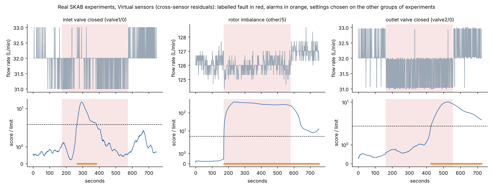
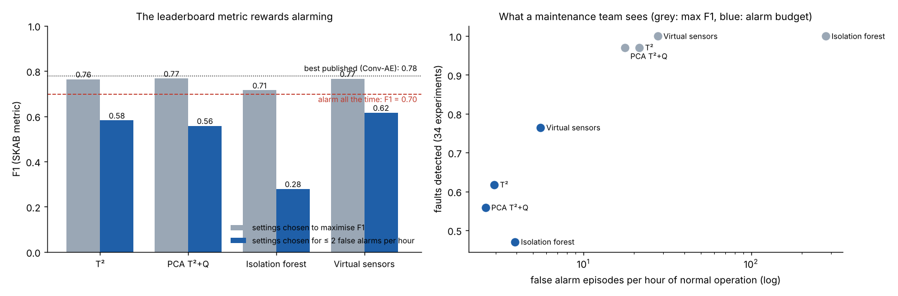

# Pump fault detection on a real testbed: reproduce the benchmark, then measure what maintenance needs

[](https://github.com/kawtar-bellamine/pump-pdm/actions/workflows/tests.yml)

An anomaly detector on a pump is judged by the people who receive its alarms: does it catch the fault, how fast,
and how often does it ring for nothing? This project answers on **real sensor data** from a pump testbed, after
first **reproducing the published benchmark exactly**, so the numbers can be trusted.

**Data: [SKAB, the Skoltech Anomaly Benchmark](https://github.com/waico/SKAB)** (Katser & Kozitsin, GPL-3.0),
fetched at a pinned commit. A water circulation loop with a centrifugal pump, valves and a tank; 8 sensors sampled
every second (two vibration accelerometers, motor current, voltage, pressure, flow, two temperatures); 34 experiments
with labelled faults: inlet valve closed (16), outlet valve closed (4), fluid leaks and additions (4), rotor
imbalance (5), water level (3), cavitation (2). Benchmark protocol: the first 400 seconds of each experiment are
normal operation for training, the rest (23,801 seconds) is the test.



## Method

- **Reproduction**: the leaderboard's T² and T²+Q rows are recomputed with the SKAB authors' own code (fetched, not
  copied) and scored with this project's metric, which is checked against theirs in the tests.
- **Detectors** ([`pdm/detectors.py`](pdm/detectors.py)), all fitted per experiment on the 400 normal seconds:
  Hotelling T², PCA T² + Q (Box's approximation for the Q limit), isolation forest, and **virtual sensors**: each
  sensor is predicted from the seven others by a ridge regression; a fault breaks the physical relations between
  flow, pressure, current and vibration, and the score is the mean squared standardised residual.
- **Settings** (alarm limit as a multiple of the training limit, causal smoothing over 1 to 60 s) are chosen
  **leaving one group of experiments out**: tuned on two of {inlet valve, outlet valve, others}, tested on the
  third. Three selection rules: maximise F1 (the leaderboard metric); keep under 10% of normal seconds in alarm;
  and the maintenance rule, **detect the most faults with at most 2 false alarm episodes per hour**.
- **Event metrics** ([`pdm/metrics.py`](pdm/metrics.py)): faults detected, delay from the fault to the first
  alarm, false alarm episodes per hour of normal operation.

## Findings

1. **The published results are reproduced to the last digit.** T²: F1 0.66, false alarm rate 19.21%, missed alarm
   rate 42.6%; T²+Q: 0.76, 26.62%, 24.92%: the leaderboard's values exactly.

2. **The leaderboard metric rewards alarming.** 54% of the test seconds are labelled faulty, so a detector that
   **alarms all the time scores F1 = 0.70**, close to the best published result (Conv-AE, 0.78). Tuned for F1, the
   simple detectors here reach 0.76 to 0.77, at the level of the deep models of the leaderboard, but by keeping
   45% to 50% of the normal seconds in alarm: 18 to 28 false alarms per hour, unusable on a plant.

3. **With an alarm budget, the virtual sensors find the most faults.** Settings chosen for at most 2 false alarms
   per hour on the other groups, tested on the held-out group:

   | Detector | Faults detected (34) | Median delay | False alarms per hour | F1 |
   |---|---|---|---|---|
   | Hotelling T² | 21 | 52 s | 2.9 | 0.58 |
   | PCA T² + Q | 19 | 27 s | 2.6 | 0.56 |
   | Isolation forest | 16 | 91 s | 3.9 | 0.28 |
   | **Virtual sensors** | **26** | 63 s | 5.6 | **0.62** |

   Rotor imbalance is caught every time within seconds; closed valves are caught 13 times out of 16 (inlet) and 4
   out of 4 (outlet), in one to three minutes; leaks and additions of fluid are the blind spot (1 out of 4). The
   alarm budget learned on two groups is exceeded on the third: on a new installation, the limit has to be checked
   during commissioning.

   

4. **Most "false" alarms are the pump recovering.** 80% to 86% of the false alarm seconds fall within three minutes
   after a labelled fault ends: the label stops when the valve is reopened, the flow, pressure and temperatures take
   minutes to settle. For maintenance these are not false alarms; scored point by point, they count as such.

5. **Real data has quirks a simulation would not have.** In one experiment (other/2) the fault starts inside the
   400 training seconds: the benchmark protocol trains that detector on faulty data. Sensors constant during the
   training part (flow fixed during warm-up) have to be dropped before any covariance is inverted.

All numbers: [`results/metrics.json`](results/metrics.json).

## Run it

```bash
pip install -r requirements.txt
./run_all.sh          # fetches SKAB at a pinned commit, reproduces the leaderboard, evaluates, draws the figures
pytest -q
```

## Limits and next steps

- 34 experiments on one testbed; the faults are induced, on purpose and for a few minutes. A plant's degradations
  are slower; the same event metrics and alarm budget apply.
- The deep models of the leaderboard (Conv-AE, LSTM-AE) are the next comparison under the alarm budget, where the
  F1 metric does not decide alone.
- An alarm suppression window after a fault is cleared, and a diagnosis of which sensor relation broke (the virtual
  sensor residuals already point to it).

Kawtar Bellamine, 2026.
